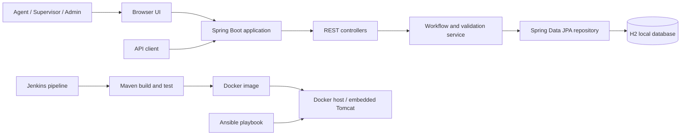
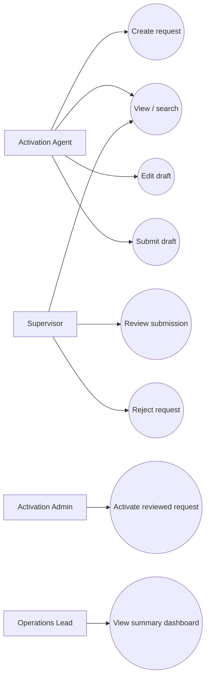
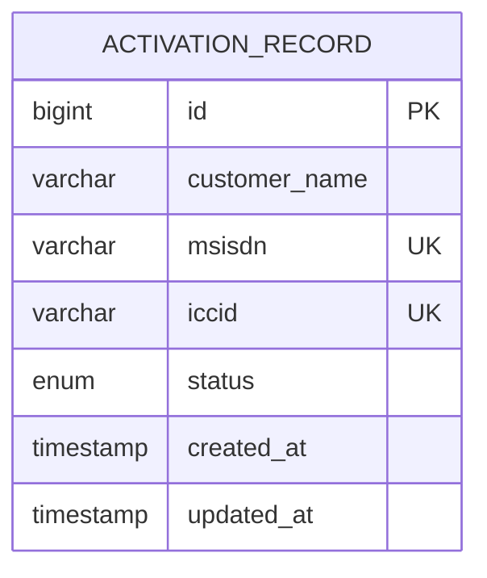

# Architecture and interfaces

## Minimum architecture

The UI and REST API are served by one Spring Boot process. Embedded Tomcat listens on port 8080. Local development uses a file-backed H2 database under the ignored `data/` directory. CI can use a disposable in-memory database. On a real deployment, substitute a managed relational database, trusted identity provider, secrets manager, reverse proxy/TLS, and an operational audit design.

## Use cases

## Data model

An activation record has no child relations in the MVP. A production workflow should add immutable status-change/audit events with actor ID, timestamp, reason, and correlation ID.

## API list

| Verb/path | Input / output | Rules |
|---|---|---|
| `POST /api/activations` | JSON `customerName`, `msisdn`, `iccid`; created record | Valid identifiers; initial state `DRAFT`; MSISDN and ICCID unique |
| `GET /api/activations/{id}` | Record JSON | 404 when absent |
| `GET /api/activations?query=&status=` | Array of matching records | Query and status may be combined |
| `PUT /api/activations/{id}` | Record JSON; updated details | `X-Actor-Role: AGENT`; draft only |
| `POST /api/activations/{id}/status` | `{"status":"SUBMITTED"}` | Role checked against exact current→next transition |
| `GET /api/dashboard` | Status-to-count JSON map | Includes zeroes |
| `GET /actuator/health` | Spring health JSON | Liveness/readiness probe |

API errors have an `error` field. Validation errors return 400, missing records 404, forbidden role changes 403, and duplicate/invalid state conflicts 409. The `X-Actor-Role` value is deliberately only a classroom simulation; it is forgeable and must never be treated as production identity.
