# DevOps lifecycle and delivery workflow

## Lifecycle

```mermaid
flowchart LR
    Plan[Plan backlog / acceptance criteria] --> Code[Feature branch / code / review]
    Code --> Build[Maven compile and unit tests]
    Build --> Package[Package JAR and archive]
    Package --> Test[Selenium journeys and reports]
    Test --> Image[Build versioned Docker image]
    Image --> Local[Deploy fresh local container]
    Local --> Publish[Optional registry publish]
    Publish --> Deploy[Optional Ansible / SSH deployment]
    Deploy --> Operate[Health, logs, dashboard]
    Operate --> Learn[Incidents / feedback / backlog]
    Learn --> Plan
```



## Jenkins setup

1. Install Jenkins on a supported host and install a JDK 25, Maven 3.9+, Git, Docker CLI/daemon, and Chrome/Chromium on the relevant agents. Grant Docker access only to a dedicated, trusted agent.
2. Create a Multibranch Pipeline for the GitHub repository and configure a webhook for push and pull-request events. A periodic scan may be added as a fallback.
3. Add credentials in Jenkins (never in source): ID `dockerhub` as username/password when publishing is enabled; ID `sim-deploy-key` as SSH private key for a deployment host.
4. Configure branch protection so PRs require the CI result and review. The Jenkinsfile tests, packages, and runs browser journeys on all branches; image build, local container deployment, optional registry publish, and optional remote deploy are gated to `main`.
5. Set Jenkins job parameters: `DEPLOY_LOCAL`, `PUBLISH_IMAGE`, `DOCKER_IMAGE`, `DEPLOY_HOST`, and `DEPLOY_USER`. Local deployment is enabled by default and binds the container to port 18080, preserving port 8080 for Jenkins. The agent must have Docker daemon access. Publishing requires Docker Hub credentials and a valid registry image path. Remote deployment requires an SSH-accessible Docker host and published image. Keep `DEPLOY_HOST` empty to disable remote deployment.
6. Verify the build log, `target/*.jar` archived artifact, Surefire/Failsafe JUnit reports, and (on `main`) the versioned image, local container health endpoint at `http://localhost:18080/actuator/health`, and optional registry/remote deployment. A Jenkins server must be authenticated and configured to execute the job; the Jenkinsfile alone is not evidence of a pipeline run.

## Feature and release flow

1. Create an issue from a backlog item; branch from `develop` as `feature/<slug>`.
2. Implement the smallest cohesive change, add/update tests and docs, then run `mvn -B clean verify`.
3. Commit with an imperative scoped message and push the feature branch to the configured remote.
4. Open a PR into `develop`; review behavior, API compatibility, test reports, and screenshots; resolve conversations; merge only after required checks pass.
5. Release from `main`, publish `vMAJOR.MINOR.PATCH` after checks, and retain the prior image tag for recovery.

## Container lifecycle evidence checklist

```powershell
docker build -t sim-activation:0.1.0 .
docker run -d --name sim-activation -p 18080:8080 -v sim-activation-data:/app/data sim-activation:0.1.0
docker ps
docker logs sim-activation
Invoke-WebRequest http://localhost:18080/actuator/health
docker stop sim-activation
docker start sim-activation
docker rm -f sim-activation
```

Use host port 18080 for the container when Jenkins occupies 8080 (for example, `docker run -d --name sim-activation -p 18080:8080 -v sim-activation-data:/app/data sim-activation:0.1.0`, then probe `http://localhost:18080/actuator/health`). The database volume is intentionally preserved when the container is removed. Remove it only when you explicitly intend to delete local training data.
